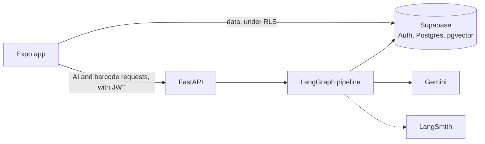

# FreshPlate

[](https://github.com/brandon-sanchez/FreshPlate/actions/workflows/ci.yml)

FreshPlate tracks the food in your fridge, freezer, and pantry, then suggests meals you can cook with what you have. Suggestions favor food that expires soon, and every ingredient in a suggested recipe maps to something in your kitchen.

The mobile app is built with Expo and React Native. The backend is a FastAPI service that runs a LangGraph pipeline on Gemini, grounded by vector search over Food.com recipes in Supabase pgvector.

<!-- Case study and demo GIFs go here (issue #38). -->

## What it does

These features work on `main` today:

- **Sign in with Google or Apple.** Each new user gets a household that owns their inventory.
- **Track inventory.** Add items by hand or scan a barcode, which looks the product up on Open Food Facts. Each item has a storage location and an expiry date. The app suggests a shelf life for each food category and storage location from USDA guidance.
- **See what expires soon.** The home screen lists items close to their expiry date.
- **Browse a recipe feed.** Answer a few optional questions, then scroll a feed of recipes built from your inventory. The feed generates more recipes in the background as you scroll.
- **Save recipes.** Saved recipes stay with your household.

These features are in progress:

- Cooking a recipe and deducting what you used from inventory. The backend endpoint and database function exist. The app screens are in [#27](https://github.com/brandon-sanchez/FreshPlate/issues/27) and [#30](https://github.com/brandon-sanchez/FreshPlate/issues/30).
- Recipe and ingredient photos, in [#56](https://github.com/brandon-sanchez/FreshPlate/issues/56).
- Automatic deploys of the API to Cloud Run, in [PR #49](https://github.com/brandon-sanchez/FreshPlate/pull/49).

## How it works



The recipe pipeline has four nodes. `analyze_inventory` filters and orders the inventory. `retrieve_recipes` finds similar recipes in pgvector. `generate_recipes` asks Gemini for structured recipes. `check_quality` rejects any recipe that uses food you don't have, then has Gemini judge whether the rest are real meals. If the check rejects recipes and time remains, generation runs once more with the reasons attached.

[Architecture](docs/architecture.md) explains each part, with diagrams of the pipeline, the recipe feed, the cook flow, and auth.

## Tech stack

| Layer | Tools |
| --- | --- |
| Mobile | Expo SDK 54, React Native 0.81, expo-router, TanStack Query, Zustand, TypeScript |
| Backend | Python 3.11, FastAPI, Pydantic, LangGraph |
| AI | Gemini `gemini-3.6-flash` for generation and judging, `gemini-embedding-001` for embeddings |
| Data | Supabase Auth, Postgres with row-level security, pgvector with an HNSW index |
| Observability and evals | LangSmith traces and experiments |
| CI | GitHub Actions: Ruff, pytest, TypeScript, and Jest |

## Repository layout

| Path | Contents |
| --- | --- |
| `mobile/` | The Expo app |
| `backend/app/` | The FastAPI service and the AI pipeline in `backend/app/ai/` |
| `backend/scripts/` | The recipe corpus loader and the eval runner |
| `supabase/migrations/` | The database schema, row-level security policies, and functions |
| `docs/` | Project documentation, starting with the architecture overview |

## Run it locally

You need Python 3.11, Node 22, the Supabase CLI, a Supabase project, and a Gemini API key.

1. Set up and start the API as described in [`backend/README.md`](backend/README.md). That guide also applies the database migrations.
2. From `mobile/`, install the dependencies and create the environment file:

	```sh
	npm ci
	cp .env.example .env
	```

3. In `mobile/.env`, set your Supabase URL and publishable key. Set `EXPO_PUBLIC_API_URL` to the address of the API.
4. Start the app and open it in Expo Go on an iOS simulator or a phone:

	```sh
	npm run ios
	```

To use the recipe feed, sign in and add a few items to your inventory.

## Run the tests

From `backend/`:

```sh
venv/bin/ruff check .
venv/bin/pytest
```

From `mobile/`:

```sh
npx tsc --noEmit
npm test -- --runInBand
```

CI runs the same checks on every push and pull request.

## Run the evals

The offline evals need no keys:

```sh
cd backend
venv/bin/python -m scripts.run_evals --mode offline
```

[Run the evals](docs/run-evals.md) covers the live mode, which calls Gemini and records a LangSmith experiment. The [evaluation reference](docs/evals.md) defines each metric and lists the latest scorecards.
