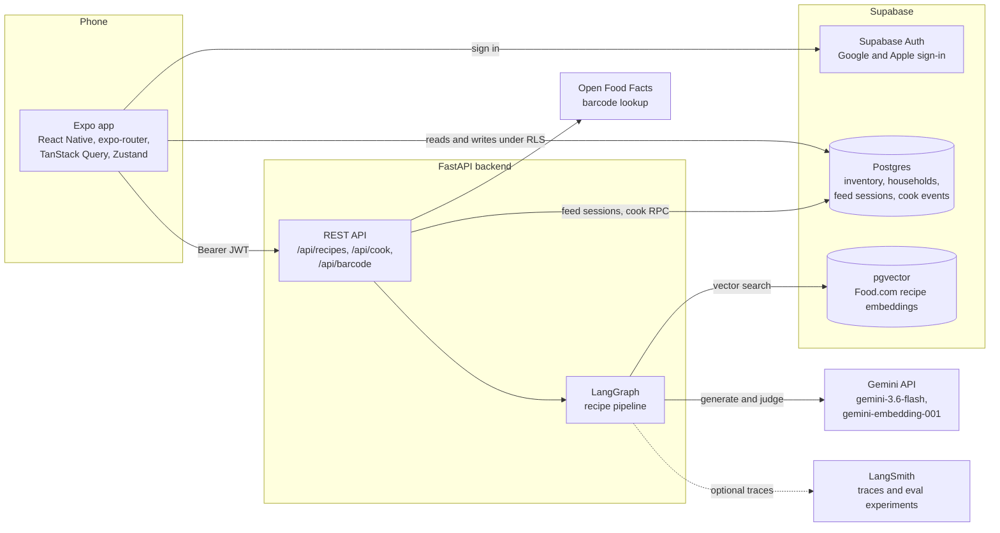
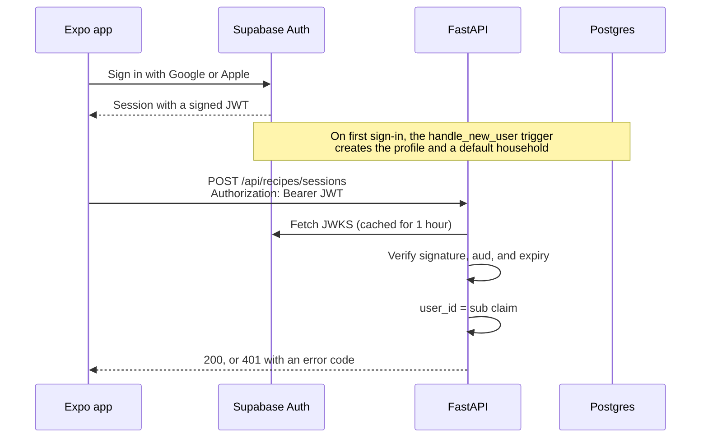
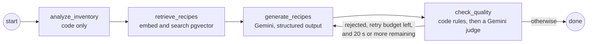
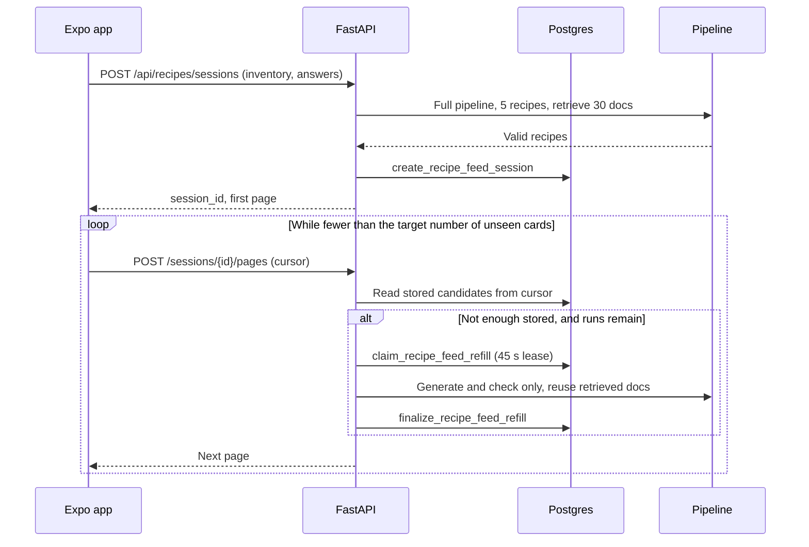
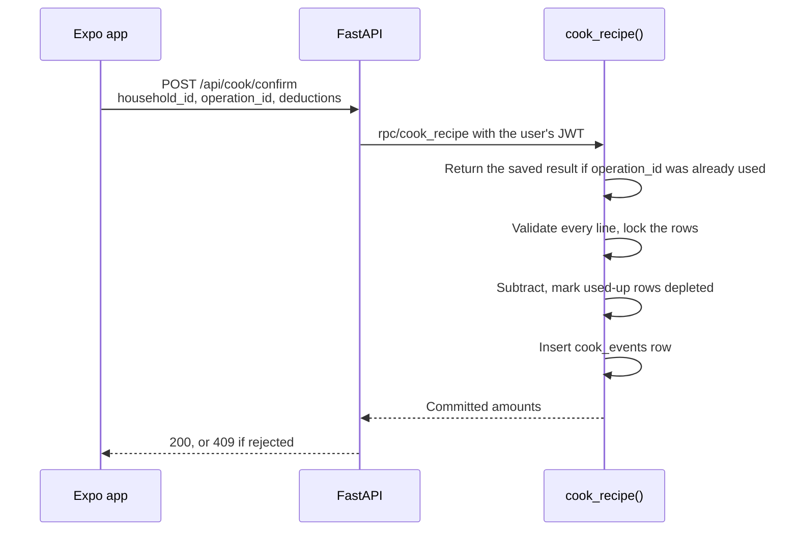

# FreshPlate architecture

FreshPlate is a mobile app that tracks the food in your kitchen and suggests meals you can cook with it. This page explains how the pieces fit together and why they are shaped the way they are. It describes the code on `main`.

## The app talks to Supabase for data and to the API for AI work

The Expo app reads and writes ordinary data, such as inventory, profiles, and saved recipes, directly in Supabase Postgres. Row-level security limits each user to their own household's rows. The app calls the FastAPI backend for recipe generation and barcode lookup. Recipe generation needs the Gemini key and the Supabase secret key, which can't ship in an app. Cook confirmation will go through the backend too, because it changes several rows that must succeed or fail together.

This split keeps the backend small. Simple reads and writes don't pass through it, so the API holds no inventory logic. The cost is two write paths into the same tables. The cook flow is the one place where that matters, and it goes through a single database function for that reason.

The backend has these routers, registered in `backend/app/main.py`:

| Route | Purpose |
| --- | --- |
| `GET /health` | Liveness check |
| `GET /api/me` | Returns the signed-in user's ID |
| `POST /api/barcode/lookup` | Looks up a product on Open Food Facts |
| `POST /api/recipes/suggestions` | Runs the pipeline once and returns a batch |
| `POST /api/recipes/sessions` | Starts a recipe feed session |
| `POST /api/recipes/sessions/{session_id}/pages` | Returns the next page of a feed session |
| `POST /api/cook/confirm` | Deducts the ingredients used in a cook |

## The backend checks the Supabase JWT on every request

Supabase Auth issues the user a JWT when they sign in with Google or Apple. The app sends that token as `Authorization: Bearer <token>`. The backend never sees a password and keeps no sessions of its own.

`backend/app/core/auth.py` verifies the token against the project's public signing keys (JWKS), which it caches for an hour. If a token names a key ID the cache does not have, the backend refetches the JWKS once before it rejects the token, so a key rotation does not lock users out for the length of the cache. Routes take the verified user ID through the `CurrentUserId` dependency.

The cook endpoint goes one step further. It forwards the user's own JWT to Supabase when it calls the `cook_recipe` function. Postgres then sees the real user in `auth.uid()`, and row-level security applies as if the app had made the call itself.

## A four-node LangGraph pipeline turns inventory into recipes

`backend/app/ai/agents/graph.py` wires four nodes in a line, with one loop back from the quality check to generation.

Each node has one job:

1. `analyze_inventory` drops expired, used-up, and zero-quantity items. It puts items that expire within five days first and flags them, so the prompt can favor food that is about to go bad. It uses no model.
2. `retrieve_recipes` turns the item names into one query, embeds it with `gemini-embedding-001` (768 dimensions), and calls the `match_recipe_embeddings` function. That function searches an HNSW cosine index over the Food.com recipes in `recipe_embeddings`.
3. `generate_recipes` sends the usable items and up to five retrieved recipes to `gemini-3.6-flash` with the `generate_recipes_v3` prompt. Gemini returns JSON that must match a Pydantic schema. Each ingredient names the inventory item it uses and how much.
4. `check_quality` runs in two stages. Code checks first. Every ingredient must map to a real inventory item with the same name and unit, and it can't use more than the household has. Recipes that pass then go to a Gemini judge (`assess_meals_v1`), which labels each one `eligible`, `insufficient`, `incoherent`, `unsupported_ingredient`, or `unknown`. Only `eligible` recipes reach the user.

The code check runs before the judge because it is free and exact. A recipe that asks for three eggs when the household has two is wrong, and no model call is needed to say so. The judge handles what code can't decide, such as whether "rice and ketchup" is a meal.

### A failed check gets one retry, if there is time

When `check_quality` rejects a recipe, it writes the reasons to `quality_feedback`. The router in `route_after_quality` sends the graph back to `generate_recipes` with that feedback in the prompt when both of these are true:

- The retry count is below the limit. The limit is one retry by default.
- At least 20 seconds remain in the request's deadline.

Otherwise the graph ends and returns the recipes that passed. A feed session's first batch retries only when no recipe passed, and feed refills never retry. A retry costs one more full generation, and on a refill the user is already browsing earlier cards.

### One deadline covers the whole request

The pipeline shares one `PipelineDeadline` across all nodes. `POST /api/recipes/suggestions` gets 25 seconds. Feed sessions and pages get 30. The app gives up at 35. A Gemini call that fails with a transient error gets up to three attempts, with 1- and 2-second backoff, inside the same deadline. `GeminiProvider` refuses to start a call with less than 10 seconds left, because Gemini rejects request deadlines under 10 seconds.

The deadline keeps a slow model call from holding a request open past the app's timeout. It also causes the main failure in the live eval. When generation runs long, too little time is left for the judge. The [evaluation reference](evals.md) has the numbers.

Open [PR #73](https://github.com/brandon-sanchez/FreshPlate/pull/73) changes this pipeline. It sets Gemini's thinking level to minimal and replaces the meal judge with a checklist judge whose verdict code decides.

## The recipe feed generates ahead of the user

The Recipes tab shows a vertical stack of cards that keeps growing. One generation took 15 to 19 seconds in the live eval, so the feed can't wait until the user reaches the end. Instead, the server stores each session's recipes, and the app keeps a buffer of unseen cards.

The design has three parts:

- **The first batch does the expensive work once.** `POST /api/recipes/sessions` runs the full pipeline and retrieves 30 grounding recipes, enough for all six generation runs a session may make. The session stores the analysis and the retrieved recipes, so later refills skip embedding and vector search and run only generation and the quality check.
- **A lease makes each refill run once.** Two page requests can reach the end of the stored recipes at the same moment. `claim_recipe_feed_refill` grants one of them a 45-second lease. The other waits for that refill and returns the same recipes, so a cursor always maps to the same recipe IDs. If the owner fails, it releases the lease. If it crashes, the lease expires. Only the backend can call these functions, using the Supabase secret key.
- **The app prefetches by how fast you scroll.** `mobile/hooks/useRecipeFeed.ts` keeps between 10 and 20 unseen cards ready. It measures how fast the user moves through cards and how long a refill takes, then asks for more before the buffer runs out. If the user still reaches the end, a skeleton card holds the place until the next batch arrives.

A session stops after six generation runs. The app then offers to add items or change the answers, rather than generating forever.

## Cook confirmation deducts inventory in one transaction

When a user finishes cooking, they confirm how much of each item they used. `POST /api/cook/confirm` passes that list to the `cook_recipe` Postgres function, which applies it in one transaction.

The function guarantees these properties:

- **All or nothing.** It checks every line before it changes any row. Amounts must be positive and finite, IDs must be unique, and every item must belong to the caller's household. One bad line rejects the whole request.
- **Safe to retry.** The app creates an `operation_id` when the cook starts and stores it with the active cook. `cook_events` has a unique key on `(household_id, operation_id)`, so a repeated confirmation returns the first result and deducts nothing twice.
- **Safe under concurrency.** The function locks the item rows with `SELECT ... FOR UPDATE`. If another household member used the same item first, the deduction stops at zero. The event then records both what the user said they used (`confirmed_amount`) and what was actually subtracted (`committed_amount`).
- **No hard deletes.** An item that reaches zero gets a `depleted_at` timestamp. The function never deletes the row.

The function runs as `SECURITY INVOKER` with the user's JWT, so it gets no extra privileges. On `main`, the backend endpoint, the database function, and the app's persisted active-cook state exist. The cook screens that call them are in progress in [#27](https://github.com/brandon-sanchez/FreshPlate/issues/27) and [#30](https://github.com/brandon-sanchez/FreshPlate/issues/30).

## Image generation has a spending cap before it has images

Recipe photos are not live yet. Two pieces exist so that photo generation can't overspend once it ships:

- The `image_assets` table and the `reserve_image_asset` function deduplicate images by kind and cache key. They reserve an upper-bound cost against a global monthly cap before any provider call. A missing or zero cap turns reservations off.
- `OpenAIImageProvider` in `backend/app/ai/images/openai.py` makes one image request and checks that the result is a PNG no larger than 4096 pixels on a side. It never retries, so one reservation pays for at most one call.

## Where to go next

- [Evaluation reference](evals.md) describes the eval dataset, metrics, and latest scorecards.
- [Run the evals](run-evals.md) shows how to run them.
- [Deploy the API](deployment.md) covers Cloud Run.
- [CI/CD](ci-cd.md) explains what runs on each push.
