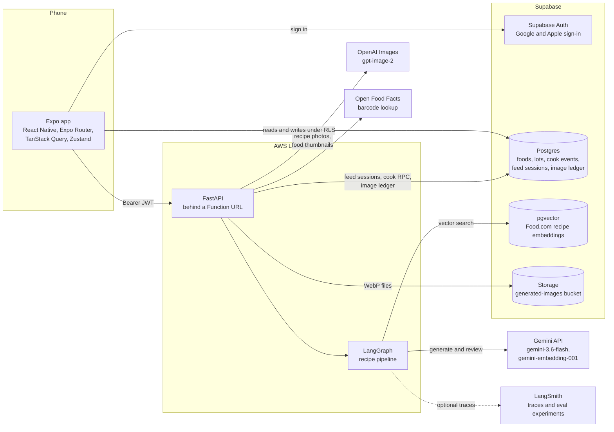
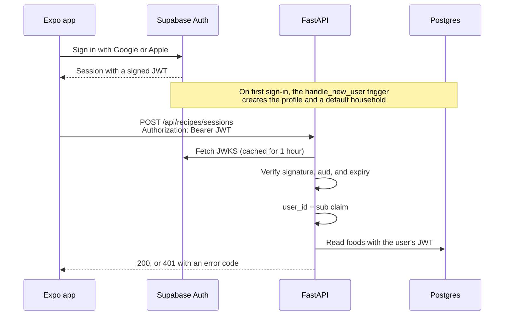
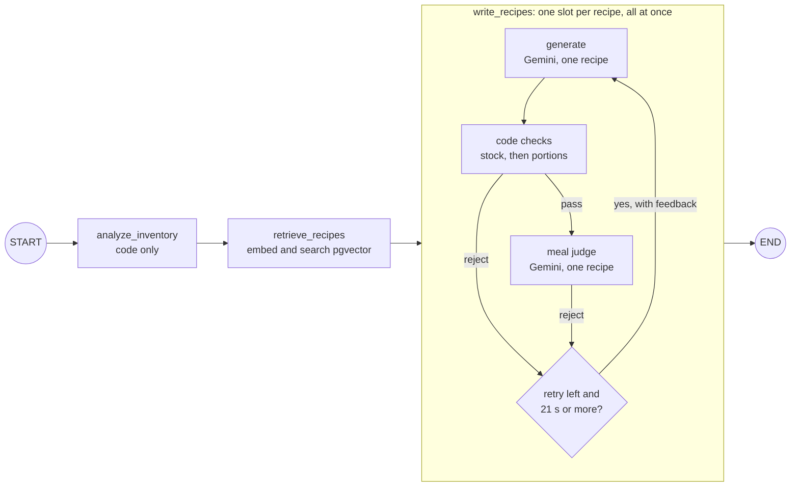
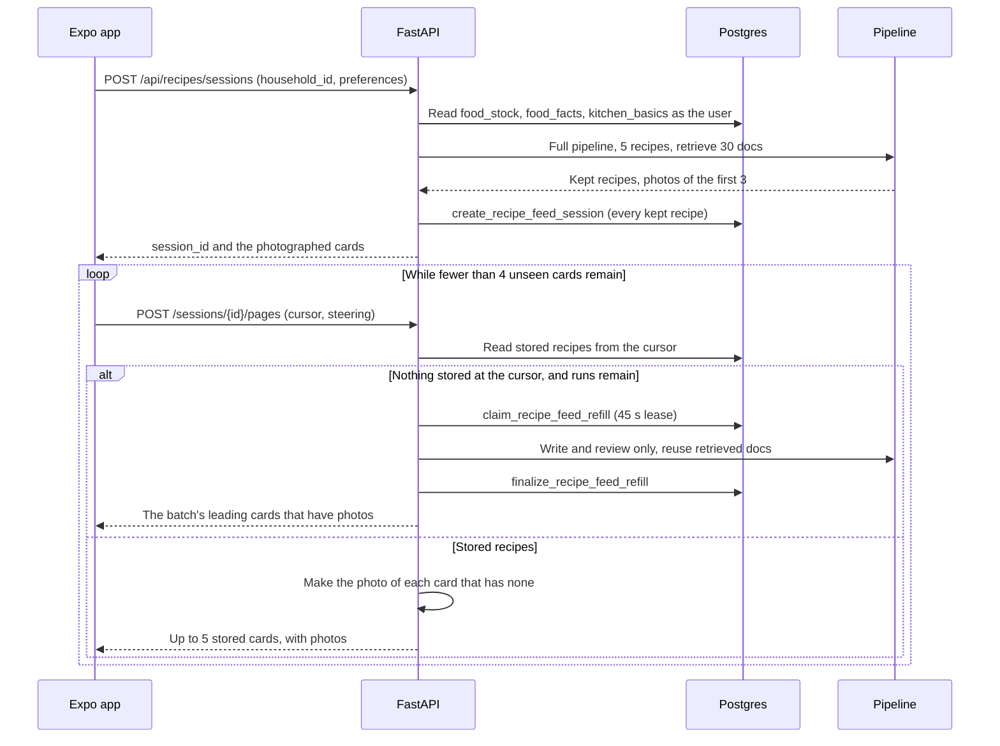
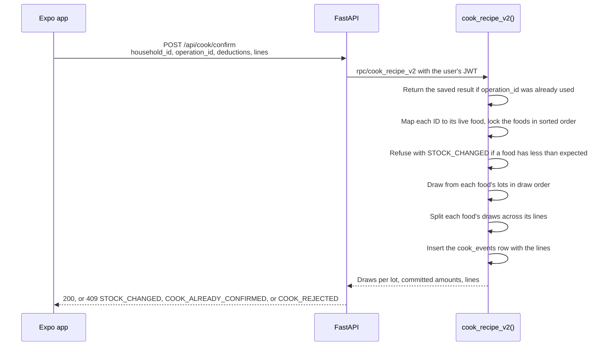

# FreshPlate architecture

FreshPlate is a mobile app that tracks the food in your kitchen, suggests meals you can cook with it, and takes what you cooked out of stock. This page explains how the pieces fit together and why they are shaped the way they are. It also lists the routes, tables, and limits an engineer reviewing the repo needs. It describes the code on `main`.

## The app talks to Supabase for data and to the API for AI work

The Expo app reads and writes ordinary data directly in Supabase Postgres: foods and their batches, kitchen basics, saved recipes, and the profile. Row-level security limits each user to their own household's rows. The app calls the FastAPI backend for the recipe feed, the cook flow, recipe photos, and barcode lookup. Those features need the Gemini key, the OpenAI key, or the Supabase secret key, which can't ship in an app.

This split keeps the backend small. Simple reads and writes don't pass through it. The API reads a household's foods as the signed-in user to generate recipes and plan a cook, and it changes stock only through the `cook_recipe_v2` database function. The cost is two write paths into the same tables. Every database function that changes stock takes the same per-food locks, whichever path calls it, so the two paths can't corrupt each other.

The backend registers these routes in `backend/app/main.py`. Every route except `/health` requires a valid Supabase JWT.

| Route | Purpose |
| --- | --- |
| `GET /health` | Liveness check |
| `GET /api/me` | Returns the signed-in user's ID |
| `POST /api/barcode/lookup` | Looks up a product on Open Food Facts and caches the answer in memory for 7 days |
| `POST /api/recipes/suggestions` | Runs the pipeline once and returns one batch, with no feed session or photos. No app screen calls it. |
| `POST /api/recipes/sessions` | Starts a recipe feed session and returns its first cards |
| `POST /api/recipes/sessions/{session_id}/pages` | Returns the next page of a feed session |
| `GET /api/recipes/sessions/latest` | Returns the caller's newest live feed session, so the app can restore it |
| `POST /api/cook/plan` | Plans the done-cooking checklist against current stock |
| `POST /api/cook/confirm` | Deducts the ingredients used in a cook |
| `POST /api/images/recipes/{recipe_id}` | Returns a recipe's photo, generating it on the first request for a feed recipe |
| `POST /api/images/foods/{food_id}` | Returns a food's thumbnail, generating it on the first request |

Errors share one shape: `{"error": "...", "code": "ERROR_CODE"}`.

## The kitchen is stored as foods and lots

A food is a thing the household keeps, such as Milk or Garlic. A lot is one physical batch of that food, with its own amount, expiry date, and storage location. Each food has one stock base: grams, millilitres, or a count of a named unit, `each_label`, such as "egg" or "can". Every amount on a lot is in its food's stock base.

| Table or view | What a row is |
| --- | --- |
| `households`, `household_members`, `profiles` | A household, a user's membership in it, and the user's profile. The `handle_new_user` trigger creates all three on first sign-in. |
| `foods` | A food in one household. Foods are archived, never deleted, and a merged food points at the food it was merged into. |
| `lots` | One batch of a food. A batch that runs out gets `depleted_at` and a `depleted_reason` of `used`, `tossed`, or `corrected`. It is never deleted. |
| `food_units` | A household's own unit word for one food, such as 1 clove = 0.1 head. |
| `food_profiles`, `food_profile_aliases` | Shared reference facts, such as density and grams per item, from USDA FoodData Central plus language-model estimates where USDA has gaps. Aliases let "Basmati rice" and "White rice" share the rice profile. |
| `food_stock` (view) | One row per live food with its unexpired total as `available`, its expired amount, soonest expiry, and lot count. Expired lots never count toward `available`. |
| `food_facts` (view) | One row per food with everything the backend unit converter needs. |
| `recently_used_up` (view) | Foods with no stock left whose last batch was used up in the past 14 days. |
| `kitchen_basics` | A staple the household always has, such as salt or olive oil, up to 30 per household. A household starts with salt, black pepper, neutral oil, olive oil, and water. |
| `cook_events` | One confirmed cook, with what was drawn from each lot. Only `cook_recipe_v2` writes it. |
| `saved_recipes` | A recipe a member saved. Members write it directly. |
| `recipe_feed_sessions`, `recipe_feed_items` | A feed session's state and its stored recipes, in feed order. Only the backend writes them. |
| `recipe_embeddings` | A Food.com recipe the pipeline retrieves from, with its 768-dimension embedding. |
| `image_assets`, `image_generation_months`, `image_generation_user_months` | The image ledger: one row per generated image, and the monthly spend in total and per user. |

Members may edit a lot's other fields directly, but a plain update can't change a lot's amount. Every amount change goes through a `SECURITY DEFINER` function that checks household membership: `add_lot`, `add_to_lot`, `set_lot_remaining`, `deplete_lots`, `restore_lots`, `cut_lot`, `combine_lots`, `restore_used_up_lot`, and `cook_recipe_v2`. Each one takes a per-food advisory lock, in sorted food ID order, before it touches a lot. Two phones changing the same foods wait for each other instead of deadlocking.

The app reads the inventory as lots joined with `food_stock`. TanStack Query caches it under `['inventory', householdId]`, and each write invalidates that key. While the query loads, Home shows skeleton rows shaped like its sections. If the query fails, Home shows an error with a retry button rather than empty counts.

## The backend checks the Supabase JWT on every request

Supabase Auth issues the user a JWT when they sign in with Google or Apple. The app sends that token as `Authorization: Bearer <token>`. The backend never sees a password and keeps no sessions of its own.

`backend/app/core/auth.py` verifies the token against the project's public signing keys, the JWKS, which it caches for an hour. If a token names a key ID the cache doesn't have, the backend fetches the JWKS once more before it rejects the token. A key rotation therefore doesn't lock users out for the length of the cache. Routes take the verified user ID through the `CurrentUserId` dependency.

When the backend reads a household's foods or calls `cook_recipe_v2`, it forwards the user's own JWT to Supabase. Postgres then sees the real user in `auth.uid()`, so row-level security and the membership checks apply to the caller. The backend uses the Supabase secret key for the feed session functions, the image ledger, and Storage, which members can't call.

## A three-node LangGraph pipeline turns the kitchen into recipes

`build_recipe_graph` in `backend/app/ai/agents/graph.py` wires three nodes in a line. The last node runs one slot per recipe, side by side, and each slot reviews its recipe as soon as its generation call returns.

Feed refills run a second graph, `build_recipe_generation_graph`, with two nodes. `initialize` sets the deadline, and `write_recipes` runs as above. A refill reuses the first request's analysis and retrieved recipes, so it skips embedding and vector search.

### Each node has one job

1. **`analyze_inventory`** gets one line per food, which the API reads from the `food_stock` and `food_facts` views as the caller. Each line has the food's unexpired total, its batch count, its next expiry date, and its unit facts. The node drops foods with nothing left. It lists the units the converter can turn into a number for each food, such as `head, clove, g` for garlic. Foods that expire within five days go first and carry a flag, so the prompt can favor food that is about to go bad. The node also drops any kitchen basic the household tracks as a food. It uses no model.
2. **`retrieve_recipes`** joins up to 30 food names into one query, embeds it with `gemini-embedding-001` at 768 dimensions, and calls the `match_recipe_embeddings` function. That function searches an HNSW cosine index over the Food.com recipes in `recipe_embeddings`. A single batch retrieves 5 recipes. A feed session retrieves 30, five for each of the six batches a session may generate.
3. **`write_recipes`** calls `generate_recipes`, which makes one `gemini-3.6-flash` call per recipe, five by default, and sends them all at once. A model writes the recipes of one call one after another, so separate calls finish much sooner than one call for the whole batch. Each recipe then goes through its review, which the next section describes.

Every generation call uses the `generate_recipes_v9` prompt with the same system prompt, schema, and kitchen text, which lets Gemini cache that shared start. Each call ends with its own direction, a lead food and a dish format, so the calls don't all write the same dish:

- For a meal, meat and seafood lead first, then the other foods. Condiments, drinks, and snacks lead only in a kitchen with no other lead.
- For a snack, any food except condiments and drinks can lead, with formats such as a dip or a toast.
- For a dessert, meat, seafood, condiments, and drinks don't lead, with formats such as a crumble or a parfait.

The directions shift on each feed refill. When the cook taps **More like this** or **Less like this**, every call in the next refill gets the same steering lines, which outrank its direction. Those lines name each picked recipe's foods but not its kitchen basics.

The requested dish is a meal unless the cook asks for a snack or a dessert. The "Which meal?" answer decides when it is set. Otherwise the free-text answer decides, and "snack", "dessert", or "something sweet" counts only in a clause with no negation. Every feed page returns this choice as `requested_dish`, so the app can say which dish an empty feed couldn't make.

Gemini returns JSON that must match a schema built for this kitchen. An ingredient's unit must be one of the units the kitchen's foods are measured in. The prompt names foods by short labels such as `f1` and `f2`, and kitchen basics by `k1` and `k2`, not by 36-character IDs, because output length sets a call's time. `generate_recipes` maps labels back to food IDs as soon as a response parses. A basic maps to no food ID, so cooking never deducts it.

Each recipe reads like a cookbook page: a short headnote, active and total time, the equipment, ingredients in order of first use with a spoken amount such as "3 cloves" and prep such as "minced", and structured steps. Each step has an optional phase label such as "Rice" or "Finish", its instruction, a doneness cue, an optional time and reason, and the foods it uses.

### Code checks run before the meal judge

`review_recipe` in `backend/app/ai/agents/meal_quality.py` reviews one recipe in three stages and stops at the first rejection:

1. **Stock checks in `check_quality`.** Every ingredient must map to a listed food or carry a kitchen basic's label. The converter turns each amount into the food's stock base, and the recipe fails only when the exact amounts for a food add up to more than the household has. Estimated and unconvertible amounts pass, because the cook confirms them at the checklist. Code then tidies the recipe: it strips step numbers the model copied, orders ingredients by the step that first uses them, and drops a spoken amount written as a decimal.
2. **Portion checks in `meal_portion_issue`, for meals only.** A meal whose foods weigh under 40 g per serving, not counting condiments, drinks, and kitchen basics, has no main component and fails as `wrong_dish`. A meal with under 100 g of food per serving, basics included, fails as `insufficient`. When any ingredient's weight is unknown, these checks pass the recipe on.
3. **The meal judge, `assess_meals_v5`.** It makes one Gemini call per recipe. The judge answers a checklist: the main component, any foods it names that the kitchen doesn't have, whether most people would eat it on its own as the requested dish, whether the portions are realistic, and whether the steps make sense. Code, not the model, turns the first failed answer into `unsupported_ingredient`, `wrong_dish`, `insufficient`, or `incoherent`.

The code checks are free and exact, so they go first. A recipe that asks for three eggs when the household has two is wrong, and so is 60 g of parsley served as dinner, and no model call is needed to say so. The judge handles what code can't decide, such as whether "rice and ketchup" is a meal. Both Gemini prompts run with thinking set to `minimal`.

After the slots finish, code drops a kept recipe whose title repeats an earlier one's dish: when at least three quarters of the content words in the two titles appear in both. Each review is logged with its verdict and whether code or the judge decided, and `GeminiProvider` logs each call's tokens and latency.

### A rejected recipe gets one retry if time allows

A rejected recipe is rewritten alone, in its own slot, with the rejection reason added after its direction. The other slots keep their recipes. A slot retries only when both of these are true:

- Its retry count is below the limit, which is one retry.
- At least 21 seconds remain: 10 for the generation call and 11 for the review after it.

Otherwise the slot ends without a recipe. A call that returns no recipe is the model saying the kitchen can't make the dish, so it never retries. A feed session's first batch retries its rejected slots only when no slot kept a recipe. Feed refills never retry, because a retry adds a generation and a review to the wait.

### One deadline covers the whole request

The pipeline shares one `PipelineDeadline` across all nodes. Each endpoint sets its own budget in `backend/app/core/config.py`:

| Request | Backend budget | App timeout |
| --- | --- | --- |
| `POST /api/recipes/suggestions` | 25 s | No app screen calls it |
| `POST /api/recipes/sessions` | 48 s | 56 s |
| `POST /api/recipes/sessions/{session_id}/pages` | 43 s | 56 s |
| `GET /api/recipes/sessions/latest` | 3 s | 10 s |

Each budget leaves room inside the app's timeout for a Lambda cold start, which runs before the budget starts. On a feed request, the recipe steps stop 15 seconds before the deadline to leave the photos time, so a first page gives them 33 seconds.

`GeminiProvider` refuses to start a call with less than 10 seconds left, because Gemini rejects request deadlines under 10 seconds. Generation calls therefore stop 11 seconds before the recipe steps' deadline, when that still leaves them 10 seconds, so the judge can start. A call still running then loses only its own recipe. A Gemini call that fails with a rate limit, a server error, or a timeout gets up to three attempts, with 1- and 2-second backoff plus jitter, inside the same deadline.

A failed call drops only its recipe. The batch fails with `AI_UNAVAILABLE` when any call failed and no recipe was kept, because the failed call might have written a keeper. An empty batch therefore always means every call answered, so an outage never looks like a kitchen that can't make a meal.

## The recipe feed generates ahead of the cook

The **Recipes** tab shows a vertical feed of cards that keeps growing. A batch takes tens of seconds, so the feed can't wait until the cook reaches the end. The server stores each session's recipes, and the app keeps a reserve of unseen cards.

The design has five parts:

- **The first batch does the expensive work once.** `POST /api/recipes/sessions` runs the full pipeline and retrieves 30 grounding recipes, enough for all six batches a session may generate. The session stores the analysis, the kitchen basics, and the retrieved recipes. Each refill takes the next five retrieved recipes and runs only the `write_recipes` step.
- **The first cards come back before the batch is done.** Each recipe's photo starts as soon as its review keeps it, for the first three kept recipes. The request answers once those three photos finish, and recipes still being written are dropped. The other kept recipes are stored without photos, and the page request that returns them makes their photos first. Lambda freezes an instance once it answers, so no work runs after a response.
- **A lease makes each refill run once.** Two page requests can reach the end of the stored recipes at the same moment. `claim_recipe_feed_refill` grants one of them a 45-second lease. The other waits for that refill and returns the same recipes, so a cursor always maps to the same recipe IDs. If the owner fails, it releases the lease. If it crashes, the lease expires. Only the backend can call these functions, with the Supabase secret key.
- **The app pays only for cards the cook moves toward.** `mobile/hooks/useRecipeFeed.ts` asks for the next page when fewer than 4 unseen cards remain. Until the cook first scrolls, steers, or dismisses a card, the card on screen counts as unseen, so a first batch of four or five cards buys no page before anyone moves. On a five-card batch, the first swipe starts the next batch. Once the cook scrolls, the hook measures how fast they move through cards and how long a page takes, and raises the reserve to match, up to 20 cards. **More like this** asks for the next page at once. If the cook still reaches the end, a skeleton card holds the place until the page arrives.
- **A restart restores the feed.** On mount, the hook calls `GET /api/recipes/sessions/latest`. That endpoint returns the caller's newest unexpired session with its stored cards, and it ends the page before the first card with no photo yet. It never generates recipes or photos. The app keeps dismissals and steering picks in AsyncStorage, so restored cards stay dismissed and later pages stay steered. A restored feed loads another page only after the cook has seen every restored card, or scrolls, steers, or dismisses, so reopening the app buys no generation.

A session expires 2 hours after it starts and stops after six generation runs. The app then offers to add items or change the answers, rather than generating forever.

## Cook confirmation deducts stock in one transaction

The cook starts cooking from a recipe in the feed or from its detail view. `useActiveCookStore` keeps the active cook in AsyncStorage, with an `operation_id` made when the cook starts. A **Cooking** banner on Home and Recipes reopens it. Only one cook is active at a time.

When the cook taps **Done cooking**, the checklist in `mobile/components/cook-checklist.tsx` sends the recipe's ingredients to `POST /api/cook/plan`. The backend reads the household's foods with unexpired stock as the user, converts each ingredient into its food's stock base, and sums the ingredients that use one food. Each food comes back with its available stock, the amount to pre-fill, any whole-unit rounding note, and each ingredient's mode and converted amount. Ingredients that name no food, such as kitchen basics, or a food with no stock left come back as untracked. The endpoint changes nothing.

On the checklist the cook confirms how much of each food they used, and can add a food the recipe didn't list. The request carries one deduction per food and one line per recipe ingredient matched to a food: the recipe's amount and unit, the converted amount, and the mode. The mode is `draw` when the amount converted, `small` for a seasoning-sized amount that is never drawn, and `ask` when the cook was asked. `POST /api/cook/confirm` passes both lists to the `cook_recipe_v2` Postgres function.

The function guarantees these properties:

- **Draw order.** Each amount comes from the food's unexpired lots: opened lots first, then the soonest expiry with undated lots last, then the oldest. One lot is finished before the next starts. A drawn lot is marked opened, and a lot drawn to zero is marked depleted with reason `used`. Expired lots are skipped.
- **All or nothing.** One bad line rejects the whole request. Amounts must be positive and finite, whole-unit foods such as cans and eggs take whole amounts only, two deductions can't reach the same food, and every ID must be a food or lot of the caller's household.
- **Stock that changed refuses the cook.** Each deduction carries `expected_amount`, the part of the confirmed amount the checklist expected stock to cover. With the food locks held and before any draw, the function sums each food's unexpired stock. If any food has less than its expected amount, because another member cooked or tossed it a moment earlier, the whole cook is refused with `STOCK_CHANGED` and nothing is deducted. The app plans again, marks each line whose food has less than expected, such as "Only 2 eggs left now", and keeps the cook active.
- **Safe to retry.** A lock on the household and `operation_id` serializes repeats. A repeated confirmation with the same payload returns the first result and deducts nothing twice. A repeat with a different payload deducts nothing and fails with `COOK_ALREADY_CONFIRMED`, which tells an app whose first response was lost that the cook went through.
- **Using more than the kitchen has is recorded.** A confirmed amount above the expected amount that stock can't cover stops at zero. The event records what the cook said they used as `confirmed_amount`, and what was drawn as `committed_amount` with `draws` per lot.
- **Lines for Cook Again.** Each line in `cook_events.lines` keeps the recipe's amount and unit next to the live food, its stock base, the batches it drew from, and its shortfall. A food used by several lines splits its draws across them in recipe order: each line takes its converted amount, and the last line takes the rest. Every deduction needs a line that draws from it, and every drawing line needs a deduction.
- **Older recipes still cook.** An ingredient's `inventory_item_id` holds a food ID. A recipe saved before foods existed holds a lot ID there, and the function draws from that lot's food. Merged foods are followed to the food they were merged into.
- **No hard deletes.** A lot that reaches zero gets `depleted_at`, and the function never deletes a row. The inventory shows foods from the `recently_used_up` view in a collapsed **Recently used up** section, and `restore_used_up_lot` returns a batch to stock with the amount the cook says is left.

The function runs as `SECURITY DEFINER`, because members can't change lot amounts directly. It checks household membership first and reads only that household's foods and lots.

After a confirm, the cook screen shows **Nice plate** with **Save this recipe** and **Done**. **Done** goes to Inventory, where the lower stock shows. A recipe that is already saved, or that the cook saves from this screen, goes there by itself after a moment.

## Images are generated once and capped by a monthly budget

The backend generates recipe photos and food thumbnails with OpenAI's `gpt-image-2` at low quality: 1536x1024 for a recipe and 1024x1024 for a food. Generation is off until `IMAGE_GENERATION_ENABLED` is true and an OpenAI key is set. With generation off, a request returns a placeholder result.

- **Each image is generated at most once.** A recipe photo is keyed by a hash of the photo style version, the dish title, and the set of ingredient names, normalized for case, spacing, and punctuation. Amounts, ingredient order, and steps don't change the key, so the feed and saved copies share a photo, and so do households that get the same dish. The photo prompt is built from the same title and names. A food thumbnail is keyed by its food profile, or by its normalized name when it has none, so every household's tomato shares one.
- **Spend is reserved before any provider call.** `claim_image_asset` reserves $0.012 per attempt against a global monthly cap of $10 and a per-user monthly cap of $2, both for recipes and foods combined. The backend then settles the claim with the stored image or releases it. A release refunds the reservation only when OpenAI returned an error response, which it doesn't bill.
- **Requests never retry the provider.** A failed image is attempted again only by a later request, after a 15-minute cooldown, and at most twice in total.
- **Only the caller's feed recipes start a generation.** The backend writes feed recipes, so it trusts their content. Saved recipes, which members write directly, get the matching feed photo or a placeholder.
- **Feed cards carry their photos.** Inside a feed request, each photo must be stored 5 seconds before the request deadline, and a photo with less than 10 seconds left doesn't start. A failed, over-budget, or late photo never fails the batch. A photo that missed the deadline comes back as `unavailable` with reason `late`, and the app asks for it again when its card shows a minute or more later.
- **Files are private.** Images are WebP files in the private `generated-images` Storage bucket. Responses carry a signed URL valid for 24 hours and a stable `image_key`. When there is no image, the response says `pending` or `unavailable` with a reason, and the screen shows its placeholder.

`OpenAIImageProvider` in `backend/app/ai/images/openai.py` makes one request per attempt and checks that the result is a PNG no larger than 4096 pixels on a side.

## Evals score the pipeline the app runs

`backend/scripts/run_evals.py` runs the first-page feed graph over 22 fixed kitchens, without the photo step. Code scorers check coverage, completeness, and whether the cook flow could deduct each ingredient. A separate Gemini judge, `judge_recipe_v1`, answers one yes-or-no question per stated preference and lists implausible amounts, and code turns the answers into a score. The offline mode answers every model call with a fixture, and CI runs its harness tests on every push. The live mode calls Gemini and, with a LangSmith key set, logs each run as a LangSmith experiment, so runs can be compared case by case. The live eval is not a CI gate, because it costs money and its scores vary between runs.

[Recipe evals](evals.md) defines the rubric and explains how to run the eval and read the scorecard.

## The API runs on AWS Lambda

- AWS Lambda runs the image that `backend/Dockerfile` builds, on arm64 with 2048 MB and a 150-second timeout. The Lambda Web Adapter passes each request to uvicorn, so FastAPI runs unchanged. Each instance serves one request at a time, and the function costs nothing while idle.
- The app calls the API through a public Lambda Function URL. The URL takes no AWS signature, because the API checks each Supabase JWT itself. There is no API Gateway, because its limit of about 30 seconds per request is too short for a feed batch.
- Amazon ECR stores the image. SSM Parameter Store holds the backend's settings as SecureString parameters under `/freshplate/prod`, which `python -m app.serve` loads at each cold start. CloudWatch Logs keeps the logs for 14 days.
- An AWS CDK app in `infra/`, written in Python, defines two stacks. `FreshPlateRegistry` holds the ECR repository and the deploy role, and `FreshPlateApi` holds the function, its URL, and its logs.
- `.github/workflows/deploy.yml` deploys after CI passes on `main`. It signs in through GitHub OIDC to an IAM role, so no long-lived AWS key exists. It updates the function, checks `/health`, tags a healthy image `live`, and rolls back to the previous image when `/health` fails.

The 150-second function timeout covers a photo request: up to 120 seconds for OpenAI plus its storage calls. The feed budgets stay well under it, because the app's 56-second timeout is the tighter limit. Supabase, Gemini, OpenAI, Open Food Facts, and LangSmith run outside AWS. [Deploy the API to AWS Lambda](deployment.md) has the one-time setup, the cold-start budget, and how a deploy works.

## Where to go next

- [Recipe evals](evals.md) explains what the eval measures, defines the rubric, and shows how to run it and read the scorecard.
- [How CI checks every change](ci-cd.md) explains what runs on each push.
- [Deploy the API to AWS Lambda](deployment.md) covers the one-time AWS setup and each deploy.
