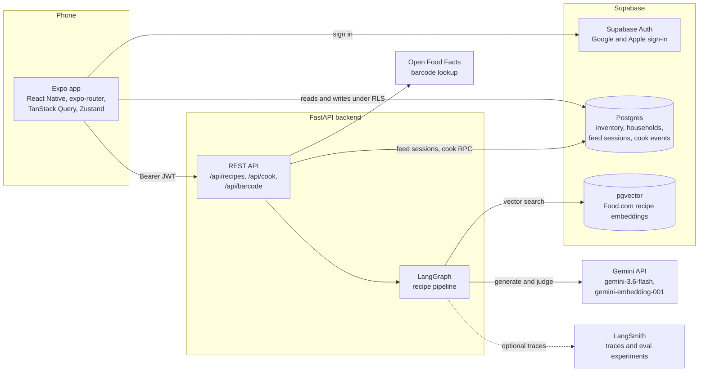
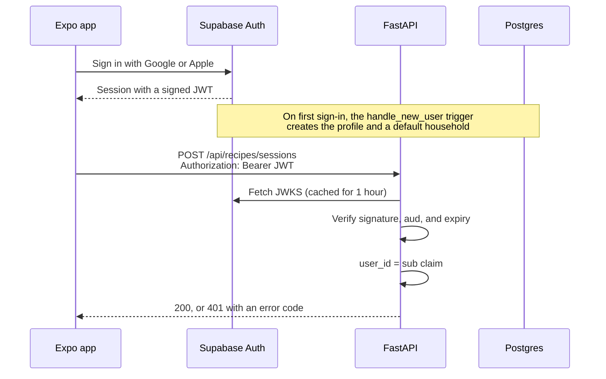
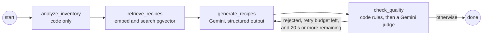
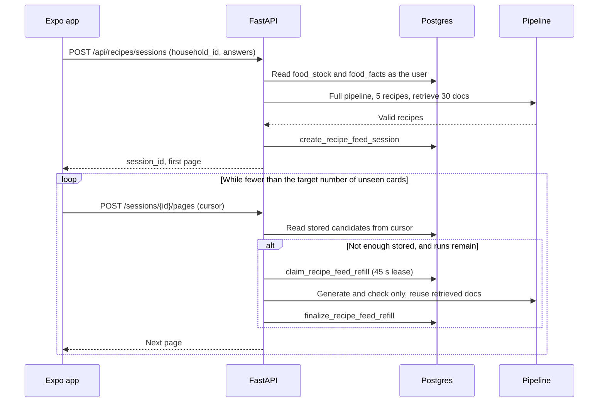
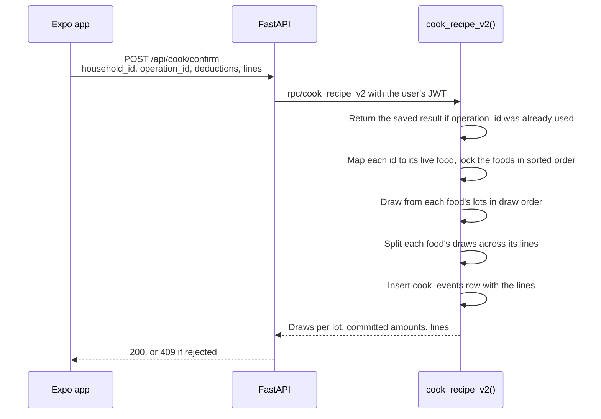

# FreshPlate architecture

FreshPlate is a mobile app that tracks the food in your kitchen and suggests meals you can cook with it. This page explains how the pieces fit together and why they are shaped the way they are. It describes the code on `main`.

## The app talks to Supabase for data and to the API for AI work

The Expo app reads and writes ordinary data, such as inventory, profiles, and saved recipes, directly in Supabase Postgres. Row-level security limits each user to their own household's rows. The app calls the FastAPI backend for recipe generation and barcode lookup. Recipe generation needs the Gemini key and the Supabase secret key, which can't ship in an app. Cook confirmation will go through the backend too, because it changes several rows that must succeed or fail together.

This split keeps the backend small. Simple reads and writes don't pass through it. The API reads a household's foods only to generate recipes, and it never writes inventory except through the cook flow. The cost is two write paths into the same tables. The cook flow is the one place where that matters, and it goes through a single database function for that reason.

The backend has these routers, registered in `backend/app/main.py`:

| Route | Purpose |
| --- | --- |
| `GET /health` | Liveness check |
| `GET /api/me` | Returns the signed-in user's ID |
| `POST /api/barcode/lookup` | Looks up a product on Open Food Facts |
| `POST /api/recipes/suggestions` | Runs the pipeline once and returns a batch |
| `POST /api/recipes/sessions` | Starts a recipe feed session |
| `POST /api/recipes/sessions/{session_id}/pages` | Returns the next page of a feed session |
| `POST /api/cook/confirm` | Deducts the ingredients used in a cook |

## The backend checks the Supabase JWT on every request

Supabase Auth issues the user a JWT when they sign in with Google or Apple. The app sends that token as `Authorization: Bearer <token>`. The backend never sees a password and keeps no sessions of its own.

`backend/app/core/auth.py` verifies the token against the project's public signing keys (JWKS), which it caches for an hour. If a token names a key ID the cache does not have, the backend refetches the JWKS once before it rejects the token, so a key rotation does not lock users out for the length of the cache. Routes take the verified user ID through the `CurrentUserId` dependency.

The cook endpoint goes one step further. It forwards the user's own JWT to Supabase when it calls the `cook_recipe_v2` function. Postgres then sees the real user in `auth.uid()`, so the membership check and the cook event's user are the caller's own.

## A four-node LangGraph pipeline turns inventory into recipes

`backend/app/ai/agents/graph.py` wires four nodes in a line, with one loop back from the quality check to generation.

Each node has one job:

1. `analyze_inventory` gets one line per food, read by the API from the `food_stock` and `food_facts` views as the caller. Each line has the food's unexpired total, its batch count, its next expiry date, and its unit facts. Expired batches never count toward the total. The node drops foods with nothing left, and it lists the units the unit converter can turn into a number for each food, such as `head, clove, g` for garlic. It puts foods that expire within five days first and flags them, so the prompt can favor food that is about to go bad. It uses no model.
2. `retrieve_recipes` turns the item names into one query, embeds it with `gemini-embedding-001` (768 dimensions), and calls the `match_recipe_embeddings` function. That function searches an HNSW cosine index over the Food.com recipes in `recipe_embeddings`.
3. `generate_recipes` sends the usable foods and up to five retrieved recipes to `gemini-3.6-flash` with the `generate_recipes_v8` prompt. Every recipe is a real meal, or a real snack or dessert when the cook asks for one. The "Which meal?" answer decides when it is set ("Snack" and "Dessert"). Otherwise the free-text answer decides, and any doubt reads as a meal. Text that names a meal ("dinner and dessert") is a meal, and "snack", "dessert" or "something sweet" counts only in a clause with no negation, so "no snack or dessert" is a meal. Every feed page returns this choice as `requested_dish`, so the app can say which dish an empty feed couldn't make. A meal has a main component, a protein or a substantial dish such as pasta, a stew or a grain bowl, and enough for a full plate. A side dish, a garnish plate or two vegetables on their own is not a meal. It makes one call per recipe and sends them all at once, because the model writes a call's recipes one after another: five recipes in one call took 43.7 seconds, and five calls at once took 12.7. Every call has the same system prompt, schema and kitchen text, which lets Gemini cache that shared start for later requests, and ends with its own direction: a lead food and a dish format, such as a soup or a sheet-pan dinner. Meat and seafood lead first, and condiments, drinks and snacks lead only in a kitchen with nothing else. A snack request uses snack formats, such as a dip or a toast, and any food except condiments and drinks can lead. A dessert request uses dessert formats, such as a crumble or a parfait, and meat and seafood never lead. The directions shift on each feed refill. A call that fails drops only its recipe. The batch fails when calls failed and none returned a recipe, so an outage never looks like a kitchen that can't make a meal. Gemini returns JSON that must match a schema built for this kitchen. An ingredient's unit must be one of the units the kitchen's foods are measured in. The prompt names each food by a short label (`f1`, `f2` and so on, in the order `analyze_inventory` lists the foods), not by its 36-character id. The model writes a food's id for every ingredient and every step that uses the food, and output length sets a call's time. `generate_recipes` maps labels back to food ids as soon as a response parses, so nothing after generation sees a label. The schema doesn't list the labels or ids, because Gemini rejects a schema that lists the foods. `check_quality` rejects an ingredient whose label names no food. Each recipe reads like a cookbook page: a short headnote, active and total time, the equipment, ingredients in order of first use with a spoken amount ("3 cloves") and prep ("minced"), and structured steps. Each step ends at one thing the cook checks, so the dish sets the step count. A step holds an optional phase label naming the meal component it works on ("Rice", "Finish"), its instruction, a doneness cue, an optional time and reason, and the foods it uses.
4. `check_quality` runs in two stages. Code checks first. Every ingredient must map to a listed food. The converter turns each amount into the food's stock unit, and a recipe fails only when the exact conversions for a food add up to more than the household has. Estimated and unconvertible amounts pass, because the cook flow confirms them. Because the calls can't see each other, code drops a passing recipe whose title repeats an earlier one's dish: when at least three quarters of the content words in the two titles together appear in both. Code then tidies each passing recipe: it strips step numbers the model copied, orders ingredients by the step that first uses them, and drops a spoken amount written as a decimal so the app formats the amount instead. Recipes that pass then go to a Gemini judge (`assess_meals_v3`). The judge answers a short checklist for each recipe, starting with whether most people would eat it on its own as the dish the cook asked for, and code turns the first failed answer into `unsupported_ingredient`, `wrong_dish`, `insufficient`, or `incoherent`. Only recipes that pass every answer reach the user.

The code check runs before the judge because it is free and exact. A recipe that asks for three eggs when the household has two is wrong, and no model call is needed to say so. The judge handles what code can't decide, such as whether "rice and ketchup" is a meal.

### A failed check gets one retry, if there is time

When `check_quality` rejects a recipe, it writes the reasons to `quality_feedback`. An empty batch writes no feedback, because it is the generator's answer for a kitchen that can't make a meal, so it never retries. The router in `route_after_quality` sends the graph back to `generate_recipes` with that feedback in the prompt when both of these are true:

- The retry count is below the limit. The limit is one retry by default.
- At least 20 seconds remain in the request's deadline.

Otherwise the graph ends and returns the recipes that passed. A feed session's first batch retries only when no recipe passed, and feed refills never retry. A retry costs one more full generation, and on a refill the user is already browsing earlier cards.

### One deadline covers the whole request

The pipeline shares one `PipelineDeadline` across all nodes. `POST /api/recipes/suggestions` gets 25 seconds. Feed sessions and pages get 30. The app gives up at 35. A Gemini call that fails with a transient error gets up to three attempts, with 1- and 2-second backoff, inside the same deadline. `GeminiProvider` refuses to start a call with less than 10 seconds left, because Gemini rejects request deadlines under 10 seconds. For that reason, generation calls stop 11 seconds before the deadline when that still leaves them 10 seconds, so the judge can still start, and a call still running then loses only its recipe.

The deadline keeps a slow model call from holding a request open past the app's timeout. It also causes the main failure in the live eval. When generation runs long, too little time is left for the judge. The [evaluation reference](evals.md) has the numbers.

Open [PR #73](https://github.com/brandon-sanchez/FreshPlate/pull/73) changes this pipeline. It sets Gemini's thinking level to minimal and replaces the meal judge with a checklist judge whose verdict code decides.

## The recipe feed generates ahead of the user

The Recipes tab shows a vertical stack of cards that keeps growing. One generation took 15 to 19 seconds in the live eval, so the feed can't wait until the user reaches the end. Instead, the server stores each session's recipes, and the app keeps a buffer of unseen cards.

The design has three parts:

- **The first batch does the expensive work once.** `POST /api/recipes/sessions` runs the full pipeline and retrieves 30 grounding recipes, enough for all six generation runs a session may make. The session stores the analysis and the retrieved recipes, so later refills skip embedding and vector search and run only generation and the quality check.
- **A lease makes each refill run once.** Two page requests can reach the end of the stored recipes at the same moment. `claim_recipe_feed_refill` grants one of them a 45-second lease. The other waits for that refill and returns the same recipes, so a cursor always maps to the same recipe IDs. If the owner fails, it releases the lease. If it crashes, the lease expires. Only the backend can call these functions, using the Supabase secret key.
- **The app prefetches by how fast you scroll.** `mobile/hooks/useRecipeFeed.ts` keeps between 10 and 20 unseen cards ready. It measures how fast the user moves through cards and how long a refill takes, then asks for more before the buffer runs out. If the user still reaches the end, a skeleton card holds the place until the next batch arrives.

A session stops after six generation runs. The app then offers to add items or change the answers, rather than generating forever.

## Cook confirmation deducts inventory in one transaction

When a user finishes cooking, they confirm how much of each food they used, in the food's stock base (grams, millilitres or a count). The request also carries one line per recipe ingredient matched to a food: the recipe's amount and unit, the converted amount, and the mode (`draw` when it converted, `small` for a seasoning-sized amount that is never drawn, `ask` when the user was asked). `POST /api/cook/confirm` passes both lists to the `cook_recipe_v2` Postgres function, which draws each amount from the food's batches (lots) and records the lines in one transaction.

The function guarantees these properties:

- **Draw order.** Each amount comes from the food's unexpired lots: opened lots first, then the soonest expiry (undated lots last), then the oldest. One lot is finished before the next starts. A drawn lot is marked opened, and a lot drawn to zero is marked depleted with reason `used`. Expired lots are skipped until someone reviews them.
- **All or nothing.** One bad line rejects the whole request. Amounts must be positive and finite, whole-unit foods (cans, eggs) take whole amounts only, each food may appear in one line only, and every ID must be a food or lot of the caller's household.
- **Old recipes still cook.** A recipe's `inventory_item_id` holds a food id. Recipes saved before foods existed hold a lot id there, and the function draws from that lot's food. Merged foods are followed to the food they were merged into.
- **Safe to retry.** The app creates an `operation_id` when the cook starts and stores it with the active cook. A lock on household plus operation id serializes repeats, so a repeated confirmation returns the first result and deducts nothing twice. A repeat with a different payload is rejected.
- **Safe under concurrency.** Every function that changes a food's stock takes a per-food advisory lock, in sorted food id order, before it touches any lot. Two phones cooking the same foods wait for each other instead of deadlocking, and a batch added during a cook lands wholly before or after it. When stock runs short, the deduction stops at zero. The event then records both what the user said they used (`confirmed_amount`) and what was actually drawn (`committed_amount`, and `draws` per lot).
- **Lines for Cook Again.** Each line in `cook_events.lines` keeps the recipe's amount and unit next to the live food, its stock base, the batches it drew from and its shortfall. A food used by several lines splits its draws across them in recipe order: each line takes its converted amount, and the last takes the rest, such as a can rounded up. Cook Again can then re-plan the recipe's own units against current stock instead of comparing bare numbers in different units. Every deduction needs a line that draws from it, and every drawing line needs a deduction.
- **No hard deletes.** A lot that reaches zero gets `depleted_at`. The function never deletes a row.

The function runs as `SECURITY DEFINER`, because members can't change lot quantities directly. It checks household membership first and reads only foods and lots of that household. The cook screens that call the endpoint are in progress in [#27](https://github.com/brandon-sanchez/FreshPlate/issues/27) and [#30](https://github.com/brandon-sanchez/FreshPlate/issues/30).

## Image generation has a spending cap before it has images

Recipe photos and ingredient thumbnails are not on any screen yet. The backend serves them from `POST /api/images/recipes/{recipe_id}` and `POST /api/images/foods/{food_id}`, and generation is off until `IMAGE_GENERATION_ENABLED` is true and an OpenAI key is set.

- Each image is generated at most once. A recipe photo is keyed by a hash of the recipe's title, ingredients and steps, so the feed and saved copies share it. An ingredient thumbnail is keyed by its food profile, or by its normalized name when it has none, so every household's tomato shares one.
- Before any provider call, `claim_image_asset` reserves an upper-bound cost against a global monthly cap ($10 by default, recipes and ingredients combined) and a per-user monthly cap. The backend then settles the claim with the stored image or releases it. A release refunds the reservation only when the provider returned an error response, which it does not bill.
- A failed image is attempted again only by a later request, after a cooldown, and only up to a fixed number of possibly billed attempts. Requests never retry the provider themselves.
- Only recipes from the caller's feed, which the backend writes, can start a generation. Saved recipes, which members write directly, get the matching feed photo or a placeholder.
- Images are WebP files in the private `generated-images` Storage bucket. Responses carry a signed URL and a stable `image_key`. When there is no image, the response says `pending` or `unavailable` with a reason, so the screen shows its placeholder.
- `OpenAIImageProvider` in `backend/app/ai/images/openai.py` makes one image request and checks that the result is a PNG no larger than 4096 pixels on a side.

## Where to go next

- [Evaluation reference](evals.md) describes the eval dataset, metrics, and latest scorecards.
- [Run the evals](run-evals.md) shows how to run them.
- [Deploy the API](deployment.md) covers Cloud Run.
- [CI/CD](ci-cd.md) explains what runs on each push.
