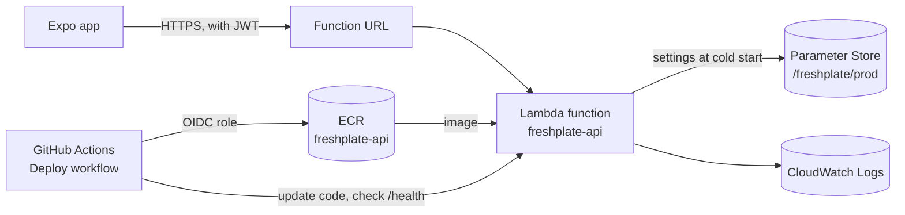

# Deploy the API to AWS Lambda

The FastAPI backend runs on AWS Lambda behind a Function URL. After the one-time setup on this page, every push to `main` that passes CI deploys itself. The first part of the page is the setup. The second part describes how a deploy works.



## Set up the deploy

You do these steps once, from the repository root. They need an AWS account, the AWS CLI 2.32 or later, Python 3.11, Node.js 22, Docker, and the GitHub CLI signed in to this repository.

1. Sign in to AWS and choose the region. `us-east-2` is the region of the Supabase project, so calls from the API to the database stay inside one region.

	```bash
	aws login
	export AWS_REGION=us-east-2
	aws sts get-caller-identity
	```

	The last command prints your account ID. If a `cdk` command later says it can't find credentials, run `eval "$(aws configure export-credentials --format env)"` and try again.

2. Install the CDK app and bootstrap the account. Bootstrapping creates the bucket and roles that CDK deploys through.

	```bash
	cd infra
	python3.11 -m venv .venv
	.venv/bin/pip install -r requirements.txt
	npx aws-cdk@2.1148.1 bootstrap
	```

3. Enter the backend's settings as SecureString parameters. Each prompt hides what you type. Use the values from `backend/.env`.

	```bash
	for name in SUPABASE_URL SUPABASE_PUBLISHABLE_KEY SUPABASE_SECRET_KEY GEMINI_API_KEY; do
		read -rsp "$name: " value && echo
		aws ssm put-parameter --name "/freshplate/prod/$name" --type SecureString \
			--value "$value" --overwrite --output text --query Version
	done
	```

	To turn on recipe and ingredient photos, add `OPENAI_API_KEY`, `IMAGE_GENERATION_ENABLED` (`true`), and, if you want a cap other than the default, `IMAGE_GENERATION_MONTHLY_CAP_MICROUSD`. To send traces to LangSmith, add `LANGSMITH_TRACING` (`true`), `LANGSMITH_API_KEY`, `LANGSMITH_ENDPOINT`, and `LANGSMITH_PROJECT`. Use the same loop with those names. Leave `DEBUG` out, so the deployed API serves no `/docs` page.

4. Deploy the image registry and the GitHub deploy role.

	```bash
	npx aws-cdk@2.1148.1 deploy FreshPlateRegistry
	```

	An account holds one GitHub OIDC provider. If `aws iam list-open-id-connect-providers` already lists one for `token.actions.githubusercontent.com`, pass its ARN instead of creating a second one:

	```bash
	npx aws-cdk@2.1148.1 deploy FreshPlateRegistry \
		-c github_oidc_provider_arn=arn:aws:iam::ACCOUNT_ID:oidc-provider/token.actions.githubusercontent.com
	```

5. Push the first image. The function can't be created until the repository holds an image tagged `live`.

	```bash
	cd ..
	account=$(aws sts get-caller-identity --query Account --output text)
	registry="$account.dkr.ecr.$AWS_REGION.amazonaws.com"
	aws ecr get-login-password | docker login --username AWS --password-stdin "$registry"
	docker build --platform linux/arm64 --provenance=false --tag "$registry/freshplate-api:live" backend
	docker push "$registry/freshplate-api:live"
	```

6. Deploy the function. CDK prints the Function URL as `FreshPlateApi.ApiUrl`.

	```bash
	cd infra
	npx aws-cdk@2.1148.1 deploy FreshPlateApi
	api_url=$(aws cloudformation describe-stacks --stack-name FreshPlateApi \
		--query "Stacks[0].Outputs[?OutputKey=='ApiUrl'].OutputValue" --output text)
	curl "${api_url}health"
	```

	The `curl` command prints `{"status":"healthy","service":"freshplate-api"}`. The first request takes a few seconds, because Lambda starts the container.

7. Give GitHub Actions the role and the region. Until `AWS_DEPLOY_ROLE_ARN` is set, the Deploy workflow skips every run.

	```bash
	gh variable set AWS_REGION --body "$AWS_REGION"
	gh variable set AWS_DEPLOY_ROLE_ARN --body "$(aws cloudformation describe-stacks \
		--stack-name FreshPlateRegistry \
		--query "Stacks[0].Outputs[?OutputKey=='DeployRoleArn'].OutputValue" --output text)"
	```

8. Point the app at the deployed API. In `mobile/.env`, set `EXPO_PUBLIC_API_URL` to the Function URL, then restart Expo with `npx expo start --clear`. Expo copies the value into the bundle when it builds it, so a running bundle keeps the old URL.

## How a deploy works

### What starts a deploy

The `Deploy` workflow (`.github/workflows/deploy.yml`) runs when the `CI` workflow completes. It deploys only when all of these are true:

- CI succeeded.
- CI ran for a `push` event, on `main`, in this repository. A CI run for a pull request, including one from a fork, never deploys.
- The commit is still the tip of `main`. A CI run that finishes after a newer commit's run would otherwise roll the API back.
- The `AWS_DEPLOY_ROLE_ARN` repository variable is set.

Deploys run one at a time. While one runs, the newest deploy waiting behind it replaces any older one that waits.

### What a deploy does

The `deploy` job runs on an arm64 runner, because the function runs on arm64.

1. Signs in to AWS through GitHub's OIDC token as the `freshplate-github-deploy` role. No AWS key is stored in GitHub.
2. Builds `backend/Dockerfile` and pushes it to the `freshplate-api` ECR repository, tagged with the commit SHA. The build reuses the layers that CI's `Docker build` job cached on `main`. A re-run reuses the image it pushed.
3. Records the image the function runs, then points the function at the new image by digest.
4. Calls `/health` on the Function URL twice, once cold and once warm, with retries. The job summary lists both times.
5. Moves the `live` tag to the new image.
6. If `/health` doesn't answer `healthy`, a step fails, or the job is cancelled after step 3, points the function back at the recorded image.

The function's configuration names the `live` tag. If CloudFormation creates the function again, it starts on the image that last passed `/health`.

### What the deploy role can do

The role trusts only GitHub OIDC tokens whose subject is `repo:brandon-sanchez/FreshPlate:ref:refs/heads/main`, for at most one hour. It can push and pull images in `freshplate-api` and call `lambda:GetFunction`, `lambda:GetFunctionUrlConfig`, and `lambda:UpdateFunctionCode` on the `freshplate-api` function. It can't change any other resource.

The workflow uses no GitHub environment, because a job with an environment gets a different OIDC subject, which the role doesn't trust.

### Change the infrastructure

The deploy role can't change the stacks. To change the function's memory, timeout, permissions, or anything else under `infra/`, merge the change, then run `npx aws-cdk@2.1148.1 deploy --all` from `infra/`. Run `npx aws-cdk@2.1148.1 diff` first to see what changes. CI runs `pytest` in `infra/`, which includes a full synth with the cdk-nag AWS Solutions checks.

### Settings

The function's `FRESHPLATE_PARAMETER_PATH` environment variable is `/freshplate/prod`. At each cold start, `python -m app.serve` reads every parameter directly under that path, decrypts it, and sets an environment variable named after the last part of the parameter name. It does this before `app.core.config` reads the environment. A parameter whose name isn't upper case, or that starts with `AWS_` or `LAMBDA_`, stops the start, as does a failed read. A failed start fails the deploy's `/health` check, which rolls back.

The image holds no settings. Without `FRESHPLATE_PARAMETER_PATH`, as with a local `docker run`, the server reads only the environment it gets.

A changed parameter reaches only new instances. To restart every instance with the same image, run:

```bash
aws lambda update-function-code --function-name freshplate-api --image-uri \
	"$(aws lambda get-function --function-name freshplate-api --query Code.ResolvedImageUri --output text)"
```

### Work after a response

Lambda freezes an instance once the response is sent, so the API does all of its work inside the request. Recipe photos are generated before the feed response returns. A photo runs in the request that asked for it and stops when that request's deadline ends or the request is cancelled. A photo stopped partway leaves its `image_assets` row reserved until the row's lease expires. For a feed photo, the lease is the request's remaining time plus 5 seconds. For a photo request, it is `IMAGE_GENERATION_TIMEOUT_SECONDS` plus 60 seconds, which also outlasts the function's 150 s timeout. The next request for that photo then starts a new attempt. When `LANGSMITH_TRACING` is `true`, `TraceFlushMiddleware` in `backend/app/core/tracing.py` uploads queued traces before each response starts, waiting at most 1 second.

### Resources and limits

| Resource | Name | Setting |
| --- | --- | --- |
| Lambda function | `freshplate-api` | Container image, arm64, 2048 MB, 150 s timeout |
| Function URL | Stack output `ApiUrl` | Public (`NONE` auth). The API checks each Supabase JWT. Buffered responses up to 6 MB |
| ECR repository | `freshplate-api` | Scan on push. Commit tags are immutable. Keeps the two newest images and `live` |
| Parameters | `/freshplate/prod/*` | SecureString, encrypted with the AWS managed `aws/ssm` key |
| Log group | Created by `FreshPlateApi` | Kept 14 days |
| Deploy role | `freshplate-github-deploy` | See the role section above |

Each instance serves one request at a time. An idle function costs nothing. The first request after an idle period starts a new instance, which takes a few seconds.

A request's budget starts when its endpoint runs. The app's timeout must also cover the time before and after the budget, so each budget leaves room for a cold start:

| Request | Backend budget | Outside the budget on a cold start | Limit |
| --- | --- | --- | --- |
| First feed page, `POST /api/recipes/sessions` | 41 s (`RECIPE_FEED_INITIAL_BUDGET_SECONDS`) | 6.5 s | App timeout, 50 s |
| Next feed page, `POST /api/recipes/sessions/{id}/pages` | 41 s (`RECIPE_FEED_PAGE_BUDGET_SECONDS`) | 6.5 s | App timeout, 50 s |
| Feed restore, `GET /api/recipes/sessions/latest` | 3 s (`RECIPE_FEED_RESTORE_BUDGET_SECONDS`) | 5.5 s | App timeout, 10 s |
| Photo, `POST /api/images/*` | 120 s for OpenAI (`IMAGE_GENERATION_TIMEOUT_SECONDS`), plus about 1 s of Supabase calls | 5.5 s | Function timeout, 150 s |

The time outside the budget is about 4 s to start an instance, 0.5 s for the first JWKS fetch, 1 s of phone network, and, for the feed, up to 1 s to flush traces. The 4 s estimate starts from a local measurement. In a container with 1.16 vCPUs and 2 GB, which is Lambda's share at 2048 MB, the image imports the app and answers `/health` 1.0 to 1.4 s after `docker run` on an Apple M2 Pro. Lambda's Graviton CPU is slower than that, and Lambda also loads the image and reads Parameter Store. The first deploy's job summary lists the real cold `/health` time. If cold Generate requests still time out in the app, lower the feed budgets in Parameter Store.

The setup fits the AWS free tier at demo traffic. Lambda includes 1 million requests and 400,000 GB-seconds a month, which is about 55 hours of requests at 2048 MB. Function URLs, standard Parameter Store parameters, and the `aws/ssm` key cost nothing. CloudWatch Logs includes 5 GB of log data a month. An image is about 170 MB compressed, and ECR's free tier holds 500 MB. The lifecycle policy keeps the two newest images, which after a healthy deploy are `live` and the image before it, so a rollback has an image to return to. After a deploy that fails `/health`, the two newest are the failed image and `live`. After two failed deploys in a row, `live` is kept as well, so three images stay until the next healthy deploy. When a deploy reuses CI's cached layers, images built from the same `requirements.txt` share their dependency layer in ECR, and each later image adds only its app layer. ECR applies the policy within 24 hours of a push, and storage past its free allowance costs $0.10 per GB-month.

The Function URL has no request rate limit. Every endpoint except `/health` answers a request without a valid JWT with a 401 in a few milliseconds.

### Deploy order

The deployed API expects the hosted database to have every migration on `main`. The Supabase GitHub integration applies each migration when its pull request merges into `main`, the same merge that starts the deploy.

When a release changes what the app and the API send each other, deploy the side that accepts both shapes first. The backend's request models reject unknown fields, so an app that sends a new field needs the API that accepts it already deployed.
